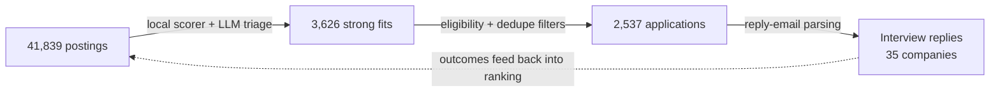

# Job-Search Pipeline: Case Study

How I turned my own job search into a data pipeline: ingesting postings from thousands of company job boards, scoring fit with a two-stage ML/LLM cascade, tailoring a resume per role from a verified fact bank, and closing the loop by parsing reply emails back into the ranking.

> **About this repo.** It's a write-up, not source code. The system is built on **SOVEREIGN**, a private job-search engine by [Ashwin Sharma](https://github.com/ashwin-2001), shared with me under a personal licence that doesn't allow redistribution. Below are the parts I built on top of it (**~6,200 lines across 26 files**) and what the system did over seven weeks of my own search.

## Results (Aug 11 – Sep 30, 2026)

| Stage | Count |
|---|---|
| Postings ingested and scored | **41,839** |
| Scored ≥ 7/10 for fit | 3,626 |
| Applications submitted | **2,537** to **620 companies** |
| Rejections received | 521 |
| Interview-stage replies (inbox classifier) | from **35 companies** |
| Confirmed interviews (strict funnel count) | 10 |
| Total LLM spend | **$11.37** (≈ $0.0003 per posting scored) |

**What the numbers taught me**
- The biggest drop is **applied → responded (≈97% silence)**. Volume alone doesn't beat that, so I shifted effort to tighter filtering and better resume–JD alignment.
- A cheap **local scorer in front of the LLM** kept cost to about $11 for roughly 42k postings. Only borderline postings reach the paid model.
- Most failed submissions were form-level problems: unusual required fields, multi-step flows and verification steps. That's why many applications go to a human-review queue instead of being forced through.

## What I built

### 1. Eligibility filtering: apply only where I'm a genuine fit
- Parses **minimum years of experience** out of job descriptions and drops roles outside my range
- Filters titles by seniority, internship or future-cohort status, and **security-clearance** requirements
- **Visa-sponsorship awareness**: matches companies against public H-1B sponsorship data and skips roles that explicitly won't sponsor
- Remembers which roles I applied to in the last 30 days and caps applications per company, so one employer never gets a flood of submissions

### 2. Truthful, grounded resume tailoring
- Routes each posting to the closest of several **resume variants** by keyword
- Boosts skills that appear in **both** the job description **and** my verified fact bank. It never adds a skill I don't have.
- A **level-claim checker** flags any generated text that overstates seniority compared with the fact bank
- Renders each tailored resume through a LaTeX template

### 3. Guardrails on form answers
- Answers legal, work-authorization and visa questions **only** from my stored profile, so they're never guessed
- Detects **fabricated contact details** and blocks them
- Detects "no-AI" attestation questions and **stops** instead of answering falsely
- Detects destructive actions (withdraw, delete) and never clicks them
- Anything uncertain goes to a **needs-human** queue (326 applications) instead of being submitted

### 4. Reliability and observability
- Hard **deadlines on every LLM call**, plus stall detection for stuck sessions
- Tracks dead or unreachable application hosts and backs off from them
- Failure taxonomy and funnel analytics, used to tune the minimum fit score
- Extended Workday support (the base targeted Greenhouse first)
- Unit and end-to-end tests for the eligibility and sponsorship logic

## Tech

Python · Playwright · OpenAI API · scikit-learn (local scorer) · SQLite · LaTeX · pytest

## Credits

Base system: **SOVEREIGN** by [Ashwin Sharma](https://github.com/ashwin-2001) (private, used under licence). The architecture of the scanner, scorer cascade and browser agent is his. The extensions listed above are mine.
